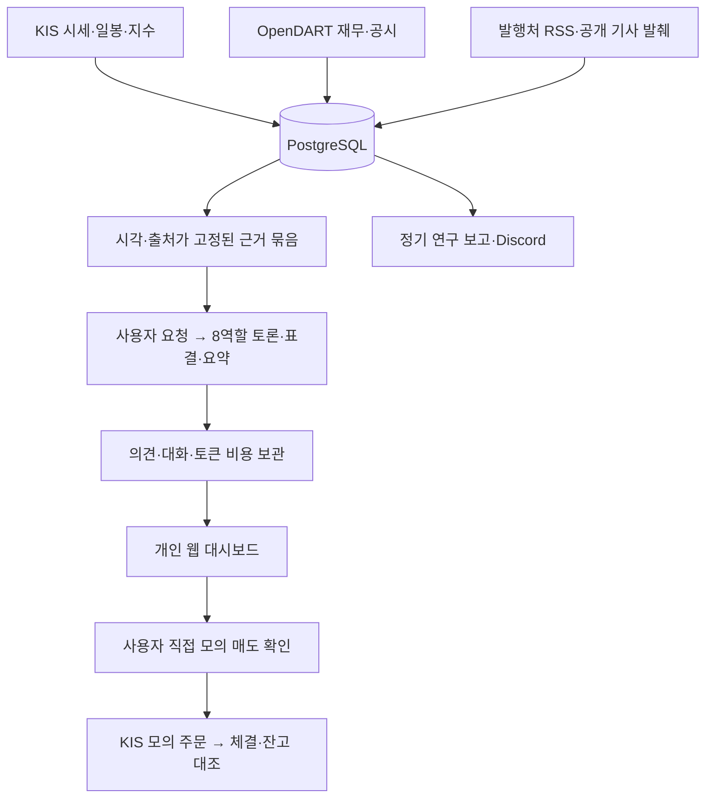

# Stock Council

### 근거를 모으고, 반론을 확인하고, 직접 결정하는 개인용 AI 투자 연구실

한국 주식의 **실제 시세·재무제표·공시·뉴스**를 모아 8개 분석 역할이 질문과 반론을 주고받는 개인용 웹 앱입니다. 짧은 결론을 먼저 읽고, 필요하면 계산식·출처·대화 원문까지 확인할 수 있습니다.

맥에서 실행하고 휴대폰에서도 확인합니다. 현재는 **기업 분석과 보유 조회, 사용자 확인 후 직접 모의 매도**를 지원합니다. AI 분석 결과가 주문을 실행하지 않습니다.

## 주요 기능

| 기능 | 하는 일 |
|---|---|
| **AI 투자위원회** | 거시경제·정책·뉴스·산업·기술·재무·시장·위험의 8개 관점으로 독립 의견 → 질문·답변·반론 → 최종 표결 → 요약 |
| **근거와 수치** | 공식 재무의 매출 성장·이익률·부채·현금 전환을 계산하고, 기간·단위·계산식·출처·미확인 사유를 표시 |
| **미래 가치 검토** | 사업 전망·경쟁력·현금 창출과 가격을 함께 검토. 주가 하락이나 20일선 하회만으로 매수 의견을 배제하지 않음 |
| **자료 수집** | KIS 가격·일봉·지수, OpenDART 재무·공시와 사업보고서 발췌, 발행처 RSS·허용된 공개 기사 일부 |
| **검토 내역함** | 진행·완료·보류·종료를 분리하고, 기업별 저장 대화·결론·비용을 다시 확인 |
| **보유 주식** | 수량·평균 매수가·평가금액·수익률·비용 후 예상 손익과 증권사 주문 상태 |
| **직접 모의 매도** | 선택 수량의 세금·수수료·예상 수령액 확인 → 최종 확인 → 지정가 전송. 미체결 잔량도 직접 취소 |
| **AI 비용 관리** | 월 예산·토큰 사용량·모델별 비용·진행 중 예약·미확정 비용을 구분 |
| **연구 보고** | 수집 현황과 정기 요약. 설정한 개인 Discord 채널로도 보고 |

8명 중 **6명 이상 찬성**하면 위원회 기준을 통과합니다. 찬성률은 주가 상승 확률이 아니며, 역할별 발언이 서로 독립된 정보원이라는 뜻도 아닙니다.

## 사용하는 흐름

1. **기업 선택** — 관찰 후보와 최신 재무·뉴스·공시, 자료가 부족한 부분을 확인합니다.
2. **검토 요청** — 예상 AI 비용을 확인하고 직접 시작합니다. 페이지를 열거나 갱신하는 것만으로 유료 분석이 시작되지 않습니다.
3. **토론 확인** — 저장된 단계 기준 진행률, 역할별 근거와 반론, 최종 결론을 봅니다.
4. **직접 판단** — 분석은 참고 자료로 사용합니다. 보유 주식의 모의 매도는 별도 화면에서 수량·금액을 확인해야 전송됩니다.

### 주요 화면

| 경로 | 화면 |
|---|---|
| `/committee` | 기업 선택·AI 투자 대화방 |
| `/committee/reviews` | 진행·완료·보류·종료 내역 |
| `/orders` · `/holdings` | 보유 주식·수익률·주문 상태 |
| `/sell` | 직접 모의 매도·비용 계산 |
| `/financials` | 공식 재무제표와 지표 |
| `/theses` · `/ideas` | 사업·가치 가정과 관찰 근거 |
| `/overview` | 수집 상태·운영 현황·정기 요약 |
| `/ai-costs` | AI 비용·예약·월 잔여 예산 |

## 구조



| 구분 | 구성 |
|---|---|
| 서버 | Java 21 · Spring Boot 4 · Spring Security |
| 저장 | PostgreSQL 16 · Spring JDBC · Flyway |
| 화면 | Thymeleaf · JavaScript · CSS, 모바일 대응 레이아웃 |
| AI | OpenAI API · 구조화 응답 검증 · 호출 전 비용 예약 |
| 실행 | Gradle Wrapper · Docker Compose의 DB · 로컬 JVM |
| 개인 원격 접속 | Tailscale Serve의 비공개 HTTPS |

```text
src/main/java/com/personaltrader/
├── committee/   AI 회의·요청 확인·진행 상태·비용 원장
├── research/    공시·재무·뉴스·기업 가치 근거·정기 요약
├── marketdata/  실제 시세·지수·관찰 후보
├── orders/      직접 모의 매도·대조·비용 계산·과거 원장 조회
├── broker/      KIS 연결과 비공개 계좌 설정
├── discord/     개인 연구 보고
├── security/    인증·CSRF·접근 경계
└── web/         페이지와 API
src/main/resources/
├── templates/  화면
├── static/     JavaScript·CSS
└── db/migration/  보존하는 DB 변경 이력
scripts/        설치·실행·백업·점검 도구
docs/           작업 기준·구조·보안 문서
```

## 로컬 실행

필요한 도구는 **macOS, Java 21, Python 3, Docker Desktop, Git**입니다. Gradle Wrapper를 사용하므로 시스템 Gradle이나 IntelliJ는 필수가 아닙니다. 아래 명령은 프로젝트 폴더에서 실행합니다.

### 처음 설치할 때

```sh
python3 scripts/setup-db-credentials.py
python3 scripts/setup-local-login.py
docker compose up -d postgres
```

외부 자료를 사용할 때 해당 연결을 준비합니다. 키는 각 스크립트의 숨김 입력에 넣습니다.

```sh
bash scripts/setup-kis-credentials.sh
bash scripts/setup-dart-credentials.sh
bash scripts/setup-openai-credentials.sh
# Discord 보고를 사용할 때만
bash scripts/setup-discord-webhook.sh
```

- KIS는 **모의투자용 키**를 사용합니다. 보유 조회·직접 모의 매도에는 비공개 `.env.kis-account`의 `KIS_PAPER_ACCOUNT_NUMBER`(앞 8자리)와 `KIS_PAPER_ACCOUNT_PRODUCT`(상품코드 2자리) 설정도 필요합니다. 현재 화면에는 새 계좌 등록 기능이 없습니다.
- OpenAI 결제·프로젝트 한도는 플랫폼에서 별도로 설정합니다. 키 저장만으로 분석을 시작하지 않습니다.
- 새 DB 비밀번호 설정은 **최초 설치용**입니다. 기존 DB 볼륨이 있으면 설정을 덮어쓰지 말고 기존 값을 유지합니다.
- 비밀 파일은 로컬에만 두고 권한 `600`을 유지합니다. 키·계좌·실제 비밀번호를 코드나 README에 적지 않습니다.

### 이미 설치한 프로젝트를 켤 때

Docker Desktop을 실행한 뒤:

```sh
docker compose up -d postgres
python3 scripts/run-background.py
```

실행기는 의존성 확인 → 빌드 → 백그라운드 시작을 수행하며, 이미 실행 중인 서버를 중복 실행하지 않습니다. 최초 DB 변경은 Flyway가 적용합니다.

접속: **[기업 분석](http://127.0.0.1:8090/committee)** · [보유 주식](http://127.0.0.1:8090/orders) · [운영 현황](http://127.0.0.1:8090/overview)

정상 종료와 비공개 백업:

```sh
python3 scripts/stop-and-backup.py
```

진행 중 AI·주문·Discord 전송이 있으면 종료를 차단합니다. 백업에는 DB와 계좌 식별 salt·연구 식별 파일이 포함되며, 별도 보관한 연결 키도 복구에 필요합니다. DB만 옮기거나 식별 파일을 새로 만들면 기존 기록에 접근하지 못할 수 있습니다.

## 휴대폰에서 보기

맥과 휴대폰의 Tailscale을 같은 개인 계정으로 연결하고, 맥에서 Serve를 설정합니다.

```sh
tailscale serve --bg http://127.0.0.1:8090
tailscale serve status
```

출력된 개인 `https://…ts.net` 주소를 휴대폰 Safari에서 열고 앱 계정으로 로그인합니다. Safari의 공유 메뉴에서 **홈 화면에 추가**하면 다시 열기 편합니다. 개인 주소는 공개 저장소에 적지 않습니다.

Serve는 tailnet 접근 규칙을 따릅니다. 개인 기기만 연결하고 **Funnel이나 인터넷 포트 개방은 사용하지 않습니다.** 앱과 DB는 계속 맥의 `127.0.0.1`에 바인딩됩니다.

**맥·Docker·앱·Tailscale이 실행 중이어야 접속됩니다.** 화면 꺼짐과 화면 잠금은 가능하지만 시스템 잠자기·덮개 닫기·전원 종료 중에는 수집과 접속이 중단됩니다. 실행기는 JVM이 동작하는 동안 유휴 잠자기를 억제합니다. 재부팅 뒤 자동 복구는 구성하지 않았습니다.

## AI 비용과 중단된 검토

- 앱의 기본 월 예산은 **$10**입니다. 호출 전에 예상 상한을 예약하고 응답의 실제 토큰 사용량으로 정산합니다.
- 한 회의는 최대 **25회 호출**(독립 8 + 반론 8 + 최종 8 + 요약 1)입니다. 회의 한 번과 API 호출 한 번은 다릅니다.
- 기본 새 회의 수는 평일 10건·주말 4건이며, 당일 횟수가 남아도 월 예산이 부족하면 보류합니다.
- `/ai-costs`의 남은 예산은 **이 앱의 계산액**입니다. OpenAI 공식 청구액·충전 잔액·세금·다른 앱 비용의 자동 조회는 연결하지 않았습니다.
- 응답·사용량이 **미확정**이면 예약액을 유지하고 같은 호출을 재전송하지 않습니다. 비용을 임의로 0원 처리하지 않습니다.

내역함에서 **일시중지·이어서 진행·최신 자료로 처음부터·검토 종료**를 선택할 수 있습니다. 재개·새 검토는 추가 비용을 직접 확인해야 하며, 서버 재시작으로 유료 검토가 자동 재개되지 않습니다. 종료는 삭제가 아니므로 기존 대화와 비용이 남습니다.

미확정 예약이 있는 새 검토는 기본 차단합니다. 소유자가 별도로 허용한 설치에서도 해당 예약 비용을 개별 확인한 새 검토에만 예외를 기록하며, 원래 호출과 예약액은 유지합니다.

## 현재 범위와 한계

- **자동 매수·매도·익절·취소는 제거했습니다.** 직접 매수 UI와 실전 주문 전송은 연결하지 않았습니다. 계좌나 키 등록으로 활성화되지 않습니다.
- 직접 모의 매도는 확인한 수량·가격·비용을 잠시 고정하고, 신선 시세·계좌 대조·만료·중복 여부를 재검사합니다. 손실 매도에는 별도 확인이 필요합니다. 접수는 체결을 뜻하지 않습니다.
- 손익은 거래세·매수/매도 수수료를 반영한 추정입니다. 계좌별 적용 요율·정산 차이·개인별 양도소득세 등은 별도 확인이 필요합니다.
- 데이터가 없거나 오래되면 그 상태를 표시합니다. 가상 가격이나 임의의 숫자로 보충하지 않습니다. 장외 가격은 마지막 실제 관측값입니다.
- RSS 요약·기사 발췌·공시 일부는 전체 원문 검증과 다릅니다. 해외 기사 전체 본문, 전 종목의 공시 누락 없는 수집, 검증된 동종업계 배수 비교는 완료하지 않았습니다.
- 가격·지표·투표만으로 상승이나 수익을 보장하지 않습니다. 모델 학습·강화학습·수익성 검증을 완료한 시스템이 아닙니다.
- 정기 자료 수집과 보고는 주말에도 실행하지만 새 유료 회의나 주문을 만들지 않습니다.

## 코드 관리와 점검

주요 화면·자료 수집·AI 회의·직접 모의 매도에 사용하는 코드를 유지합니다. 과거 거래 JSON 형식과 마이그레이션은 기존 기록을 읽는 데 필요하므로 보존합니다. 폐기된 자동매매 API는 명시적으로 `410 Gone`을 반환합니다.

빌드와 읽기 전용 운영 점검:

```sh
JAVA_HOME=$(/usr/libexec/java_home -v 21) ./gradlew bootJar --console=plain
python3 scripts/check-local-dependencies.py
python3 scripts/check-routes-readonly.py
python3 scripts/preflight-repository.py --candidates --history
```

경로 점검은 실행 중인 앱과 로그인 설정이 필요합니다. 주문·유료 AI·Discord 시험 메시지를 보내지 않습니다. HTTP·소스 점검과 실제 브라우저·휴대폰 화면 확인은 구분합니다.

`.env*`, DB, 백업, 로그, 개인 운영 문서는 Git에서 제외합니다. 업로드 전 후보 파일·스테이징·이력을 검사하고, Git 훅을 사용할 때는 `git config --local core.hooksPath .githooks`로 연결합니다. 비밀값 검사는 알려지지 않은 모든 유출 형태의 부재를 보증하지 않습니다.

Public 저장소에는 소스·일반 문서만 게시합니다. 키·계좌·실제 잔고·회의·학습 데이터는 로컬에 보관하고, 커밋 작성자 이메일의 공개 범위도 확인합니다. 이미 노출한 키·웹훅은 제공처에서 폐기·재발급해야 합니다. [게시 전 보안 점검 결과](docs/SECURITY-REVIEW.md)를 함께 확인하세요.

## 향후 학습형 분석으로의 확장

현재는 고정 근거를 모델에 전달하는 추론 방식입니다. 저장된 회의·수정 피드백·사후 관측을 평가 데이터로 정리하고, 이후 학습 가능한 모델을 미세조정하거나 별도 강화학습 환경에 연결할 수 있습니다. 현행 모델이 호출할 때마다 가중치를 자동 갱신하지는 않습니다.

먼저 출처·기간·수치 오류를 평가하고, 학습 전후를 미사용 기간의 데이터로 비교하는 단계가 필요합니다. 실제 학습·자동 재학습·학습 데이터 외부 전송은 구현하지 않았습니다. [학습형 확장 검토와 단계](docs/LEARNING-ROADMAP.md)

## 문서

- [작업 매뉴얼](docs/WORKING-MANUAL.md) — 작업 순서·현재 기능·비용과 기록 보존 기준
- [아키텍처](docs/ARCHITECTURE.md) — 자료·AI·주문 경계와 호환성
- [가치 검토 기준](docs/VALUE-REVIEW.md) — 미래 사업과 저평가 검토
- [학습형 확장 검토](docs/LEARNING-ROADMAP.md) — 기록·피드백·평가·미세조정·강화학습의 단계
- [보안 검토](docs/SECURITY-REVIEW.md) · [비밀값 처리 정책](SECURITY.md)

이 저장소에는 프로그램과 일반 기준 문서를 담습니다. 실제 잔고·계좌·회의·비용 원장은 개인 로컬 DB에 보관합니다.
