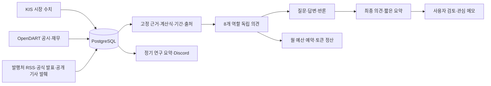

# 아키텍처

Java21 · Spring Boot4 · PostgreSQL16 · JDBC/Flyway · Thymeleaf/일반 JavaScript 기반의 개인 로컬 기업 연구 서비스다. **자동 주문은 제거하고 사용자 확인 직접 모의 매도·취소를 제공한다.**

## 자료 흐름

| 모듈 | 책임 |
|---|---|
| marketdata/research | 실제 자료 수집·기준 시각·누락 확인·사업 가정·관찰 결과 |
| committee | 고정 근거·수치 계산·유료 직접 요청·8개 역할 토론·비용·내역 |
| orders/broker | 과거 원장 호환·보유/체결 대조·불변 의도 기반 사용자 직접 모의 매도/취소. 자동 주문 없음 |
| reports | 과거 보고서 원본 열람. 새 정기 요약은 ResearchDigestService가 생성 |
| discord | 설정된 개인 채널의 연구 요약 큐·중복 방지·발송 상태 |
| web/security | 소유자 인증·CSRF·CSP·캐시 방지·반응형 UI |

## 자동매매 제거와 수동 주문 경계

`ManualTradingService`의 주기는 증권사 주문·체결·잔고 대조만 한다. 자동 후보 선택·위험 매도·익절·자동 취소 메서드와 자동 스위치 경로는 제거했다. 일반 전략 주문은 증권사 어댑터에서도 거절한다. 사용자 최종 확인의 기존 불변 모의 매도 의도만 전송할 수 있다. 잔량 취소도 소유자 확인 POST로만 요청한다. 시세·원가·수량·비용·계좌·만료·중복·3초 전송 준비 예산을 검사하고 미확정은 재전송하지 않는다. 실전 전송·직접 매수 UI는 연결 전이다.

`/orders`/`/holdings`는 보유와 수익률·비용 후 금액·주문 상태, `/sell`은 수량/비용 확인과 최종 직접 모의 매도를 제공한다. 공통 왼쪽 메뉴로 주요 화면을 이동한다. 과거 원장·JSON·마이그레이션을 보존하며 `LegacyPortfolioHistory`는 분석/이력의 읽기 전용 호환 계층이다. AI는 주문 도구가 없고 직접 주문 경로와 분리한다.

연구 식별은 비공개 `.env.research-scope`로 고정한다. 기존 연구의 계좌 지문을 처음 한 번 이어받아 이력을 보존하며 이후 계좌 설정과 분리한다. DB·기존 salt·연구 식별을 함께 백업한다.

## AI V8와 호환성

`COMMITTEE_RESEARCH_V8`: 독립8 → 질문 답변/반론8 → 최종8 → 요약1. V5/V6/V7의25단계 토론, V2~V4의17단계 자료는 당시 버전으로 읽는다. 진행률은 실제 저장 완료 작업 수이며 응답 내부 진행률/찬성률/예상 시간이 아니다.

최근5년/중간 실적은 공식 재무 원본을 전달한다. `CommitteeQuantitativeFacts`는 최신 비교 가능한 연간의 수치를 계산하고 단위·기간·연결/별도·계산식·출처·한계를 함께 전달한다. 입력 누락과 음수는 유지한다. 전년 비교는 같은 연결/별도·연속 연도·양수 분모를 요구한다. 유·무형 취득 후 현금은 두 취득 항목 모두 있어야 계산하며 확정 FCF로 부르지 않는다. 재무 준비가 없는 후보는 유료 검토를 보류한다.

고정 근거 묶음은 실제 출처 ID만 포함한다. LLM 응답은 구조화 JSON과 서버 검증으로 역할/질문 참조/출처/최종표를 확인한다. 찬성 강제·승률 생성·주문 도구는 없다. PER/PBR/PSR은 분모·주식 수·기준일·우선주/공시 시점 차이의 한계를 표시한다. 검증된 동종업계 배수는 미연결이며, 허용된 공개 기사 일부를 고정 자료로 전달해 의미를 검토한다. 전문/독립 교차검증과는 구분한다.

## 직접 요청·예산·보관

유료 회의는 인증+CSRF+confirmed POST로만 예약한다. `committee_manual_request` 불변 기록을 작업자·예약·전송 직전 모두 확인한다. 타이머는 승인된 작업만 진행한다. 같은 근거/버전은 재사용하고 자동 재시도하지 않는다. 기본 모델은 Luna6역할+mini재무/위험/요약, 월$10 앱 한도다.

소유자가 명시 보관 승인한 과거 미요청 자동 호출은 `committee_archived_call`에만 표시한다. 원본 호출/작업과 월 예약액은 남고 현재 내역/전역 차단에서만 제외된다. 새 UNKNOWN은 다시 차단하며 과거 호출을 재전송하지 않는다. 앱 계산액과 OpenAI 청구액/충전 잔액은 다르다.

`committee_result_receipt`의 명시적 POST만 완료 결과의 확인 표시를 기록한다. 선택/조회/폴링은 읽음이나 유료 요청을 생성하지 않는다.

`OfficialDocumentExcerpt`는 DART 공식 ZIP의 정확한 파일명/기업코드/보고서 종류를 확인하고 제한된 본문을 추출한다. DOCUMENT extractorVersion3로 기존 키워드 전용 수집본을 추가 갱신하며, 연간과 최신 중간 공시를 별도로 보존한다. HTML/XML을 실행하거나 엔티티를 확장하지 않는다. 주기당최대3호출·회사 순환·오류 재시도 대기를 유지한다.

`CommitteeBusinessEvidence`는 최대3000자의 실제 발췌와 기간/원본/범위 누락을 고정한다. `CommitteeEvidenceCoverage`는8역할의 담당 범위와 전달 자료/한계를 보여준다. `CommitteeEvidencePack`은 중복 설명을 줄이고 연간과 중간 비율을 분리한다. 과거 회의는 기존 버전으로 조회하며 새 유료 작업은 최신V8 근거를 요구한다. 반론 단계는 독립 주장과 자신에게 온 실제 질문, 최종 단계는 독립 주장과 전체 답변/반론, 요약 단계는 실제 최종 의견과 서버 집계를 읽어 입력 중복을 줄인다.

## 보고와 수집

`ResearchDigestService`는 매일08:30/12:00/15:40 KST의 자료 스냅샷을 저장한다. 주말에도 실행하며 예약/실제 작성/원 자료 시각을 구분한다. AI 새 호출·주문은 만들지 않는다. Discord는 기존 설정한 보고 슬롯과 관심 변화 보고를 유지하며 오래된 계좌 보고는 만료한다.

[미 연준 공식 RSS](https://www.federalreserve.gov/feeds/feeds.htm)의 통화정책 발표 제목·시각·링크를 거시 맥락으로 수집한다. 기업 직접 수혜나 전체 발표 본문 분석으로 취급하지 않는다. 허용 호스트·TLS·리다이렉트 거절·XML 외부엔티티 거절·크기 제한을 유지한다. ECB 등 검증되지 않은 피드를 연결 완료로 표시하지 않는다.

## 로컬 운영

8090/5433은127.0.0.1만 바인딩한다. 개인 폰은 Tailscale Serve HTTPS → 같은 맥의127.0.0.1:8090 경로로 접속한다. 프록시 전달 헤더는 loopback만 신뢰하며 OWNER 인증·CSRF를 유지한다. Funnel/인터넷 포트 개방은 사용하지 않는다. 맥 종료·수동 시스템 잠자기·덮개 닫기는 수집과 폰 접속을 중단한다. 정적 소스·API 점검과 브라우저/실제 폰 확인을 구분한다.

## AI 검토 재개와 종료

`CommitteeReviewControlService`가 소유자가 확인한 POST만 처리한다. 저장된 검토의 상태 시각·소유 범위·CSRF·요청 UUID를 검사하고 불변 `committee_job_action`으로 결정 이력을 남긴다. 진행 중에는 일시중지·종료, 보류 중에는 이어서 진행·처음부터 검토·종료를 제공한다. 사용 불가 조건은 버튼 옆에 표시한다. `CLOSED`는 삭제가 아니며 별도의 종료 목록에서 원본 대화를 조회한다.

재개는 기존 의견/사용량을 보존하며, 재요청이 필요한 단계에는 그 호출보다 나중의 명시적 `RESUME` 기록이 있어야 한다. 동일 미확정 호출은 재전송하지 않는다. 새 검토는 최신 근거의 원래 시각을 유지한 새 brief/job에 연결한다. `restart_of_job_id`의 유일성으로 원본 하나에서 중복 새 회의를 만들지 않고 일반 입력 재사용 규칙도 유지한다. 월 예약과 당일 새 회의 한도를 적용한다.

로컬 소유자가 별도로 허용한 설치만 미확정 예약을 유지하는 새 검토를 지원한다. 승인 가능한 미확정 ID는 선택한 검토 자체와 그 검토에 이미 연결된 것에 한정하고, 확인창에서 비용·ID 집합이 바뀌면 거절한다. 새 회의에만 권한을 연결하며 원래 호출·예약·정산을 수정하지 않는다. 서버 복구 시 진행 중 검토는 선택 대기로 바꾸며 자동 유료 재개하지 않는다. 전송 완료 직후 의견 저장 구간은 `CommitteeWorkerState`로 추적해 중복 재개를 막는다.

기존 JSON을 위해 보안 패치된 Jackson2 호환 모듈과 MVC jackson2 설정을 유지한다. Jackson3 완전 이전은 과거 JSON과 API 호환 검증 후 별도로 진행한다.

분석 입력에서는 긴 출처 해시를 회의별 짧은 별칭으로 전달한다. 서버는 허용된 별칭만 원본ID로 복원해 저장하므로 과거/현재 의견의 실제 출처를 유지한다. 출처 이름 단축은 근거 삭제나 검증 완화를 뜻하지 않는다. 최근 직접 검토한3개 기업은 상위10개에서 빠져도 자료를 갱신하며, 저장된 일봉을 재사용하면 당시 기준일과 갱신 대기를 표시한다.

주말 정비와 남은 범위는 [점검 현황](MAINTENANCE.md)에 정리한다. 실행 전 Docker/DB 준비 검사로 실패 원인을 표시하며, 장·보유 응답이 오래되면 화면 상태를 갱신 대기로 바꾸고 직접 취소 버튼을 잠근다. 현재 철학 화면은 자동매매 없음으로 설명하고 기존 회의·거래 원본은 유지한다.

## V8 역할별 조사 자료

`COMMITTEE_RESEARCH_PACK_V8` / `COMMITTEE_RESEARCH_V8`부터 `CommitteeResearchDossier`가 고정된 Brief만 읽어8역할별 관측3개·질문2개·한계2개를 계산한다. 실제 원본ID만 사용하며 해당 역할의 dossier를 입력에 한 번 추가한다. 전체 dossier의 해시를 기본pack에 포함해 입력 재사용 기준에 반영한다. 조회 때 네트워크·유료 AI를 호출하지 않는다.

V38은 `public_information`에 nullable `publisher_summary`(900자)와 생략 표시를 추가한다. 등록된 피드의 description/content:encoded에서만 텍스트를 읽고 HTML을 제거한다. RSS 요약 추출 자체는 기사 링크를 방문하지 않는다. 별도 PublisherArticleService는 피드가 제공한 허용된 기사만 읽는다. 종목 연결은 기존 공식 발행기업/제목의 명시적 기업명 기준이다. 수집시각과 발행시각은 구분하며 기존 Brief는 수정하지 않는다. 뉴스·중요 공시·일반 공시·발행 공시별 조회 상한을 적용해 반복 발행자료의 쏠림을 줄인다.

공식 문서 추출v3은 분야별 관련 문단을 선택하고 분기 생략 안내를 제외한다. `CommitteeBusinessEvidence`는 같은 범주의 연간/중간 후보를 비교하고 모든 범주에 최소 입력 공간을 배분한다. 금융 수치에는 연간/중간 계산식과 해석 한계를 전달한다. 최종 토론은 중복 주장 대신 실제 질문 답변·수치·반론을 우선 전달한다. 요청64KB 검증 실패는 예약 전에FAILED로 기록하며 반복 진행 중 상태로 남기지 않는다.

기본pack24KB, 역할별자료/대화 포함 전체64KB,25호출,$10 예약 한도를 유지한다. 새 버전에서만 실행하며 과거V7 포함 모든 기록·원장·미확정 예약액은 그대로 조회한다.

`PublisherArticleService`/V39는 피드의 정확한 한경 기사 URL만 대상으로 명시적 무료 공개·동일 headline·지정 articleBody 구간을 확인해 최대1200자를 별도 불변 테이블에 저장한다. 최근 직접 검토한 서로 다른3개 기업·현재 관찰 기업을 우선하고 포토 제목은 제외한다. 실적/매출/수주 등 사건 제목을 먼저 읽으며,2분마다 최대3건,24시간 캐시,오류30분 대기다. TLS·정확한 호스트/경로·무쿼리·리다이렉트 금지·응답1.5MB·전체8초 취소 제한을 둔다. 비공개/유료/형식 불일치에는 원문을 추정하지 않는다. Brief의 PUBLISHER_EXCERPT·본문 시각·생략 표시를 RSS 요약/제목과 구분한다. 실제 전송은 공개 원문 일부이며 전문·독립 검증이 아니다.

## 종료된 미확정 비용의 새 기업 확인

`CommitteeNewReviewConsent`의 읽기 View는 현재 차단 사유와 현재 작업공간의 종료된 미확정 호출/예약액만 표시한다. 설치 예외가 켜진 상태에서도 모든 미확정이 같은 범위의 소유자 직접 요청+CLOSED여야 새 확인을 제공한다. Analyze POST는 별도 비용 동의와 정확한 현재 호출 집합을 확인한 뒤 coordinator의 기존 advisory lock/트랜잭션 안에서 해당 새 Brief의 `committee_unknown_review_authorization`만 추가한다. 이어지는 자료/예산/큐 검사가 실패하면 권한도 롤백한다. 읽기·목록 정리·설정은 권한을 기록하지 않으며 원래 UNKNOWN/비용/대화는 그대로 남는다. 예약/전송 직전의 기존 개별 Brief 권한 재검사는 새 미확정을 계속 차단한다.

## 실행 코드와 과거 형식의 분리 · 2026-10-19

`ManualTradingService`는 현재 보유 조회·증권사 체결 대조·사용자 확인 모의 매도·잔량 취소를 담당한다. 자동 진입·추가 매수·자동 익절 분기와 관련 의존성은 제거했다. 최종 확인의60초 의도·15초 잔고·시세/원가/비용·손실 확인·중복 요청·전송 준비 시간 검사는 유지한다. 어댑터는 PAPER/SELL 경로만 전송하고 일반 `place`는 거절한다.

현재 잔고 대조는 `KisExecutionBrokerClient.account`를 사용한다. 연결이 끊긴 이전 잔고 서비스/파서와 사용하지 않는 paper 호환 래퍼는 제거했다. `LegacyPortfolioHistory`는 연구에 필요한 원장 조회와 종료 거래 수만 제공하며 broker 전송을 하지 않는다. `PaperAllocationService`는 당시 JSON을 읽는 버전/레코드 형식만 보존한다. 과거 BUY 체결의 원가 배분과 모든 마이그레이션·분석 버전은 계속 읽을 수 있어야 한다.

기존 보유 API의 필드 모양은 유지하되 자동 추가 매수·자동 익절·실전 실행 가능 플래그는 꺼진 상태를 반환한다. 과거 설정 문구를 현재 실행 정책으로 표시하지 않는다.
